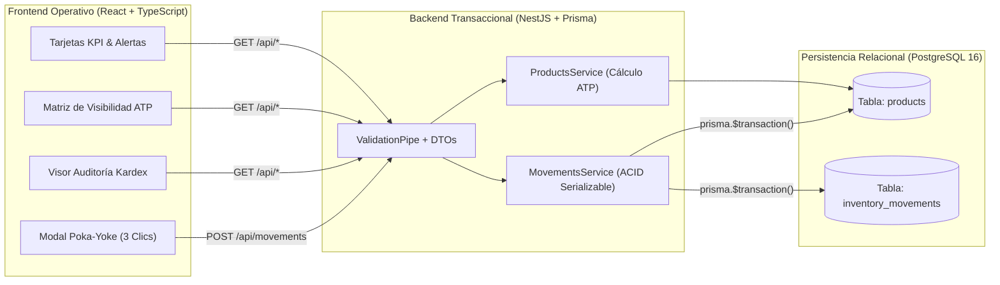

# 🛠️ Documentación Técnica del MVP Web Centralizado (Fase B)

**Proyecto:** Sistema Centralizado de Control de Inventario, Matriz ATP y Kardex Transaccional  
**Empresa:** Juliam Corp LLC (Suministros e Insumos Gastronómicos)  
**Stack Oficial:** TypeScript + React 18 (Vite/Tailwind) + NestJS 10 + Prisma ORM + PostgreSQL 16 + Docker Compose

---

## 1. Arquitectura del MVP (Fase B)

El MVP reemplaza las hojas de Excel aisladas por una arquitectura de 3 capas contenerizada que garantiza **una única fuente de la verdad (Single Source of Truth)** y bloquea por diseño los errores de captura humana detectados en el diagnóstico:



---

## 2. Reglas de Dominio e Invariantes Garantizadas en Código

### 2.1 Prohibición de Mutación Directa de Stock (Kardex Inmutable)
- No existe ningún endpoint `PATCH /products/:id/stock` que permita sobrescribir una celda de inventario.
- Todo cambio de existencia física o comprometida ocurre exclusivamente en [`MovementsService.recordMovement`](../backend/src/movements/movements.service.ts) dentro de una transacción con nivel de aislamiento **`Serializable`**:
  1. Lee el saldo actual de `Product`.
  2. Evalúa las invariantes de negocio mediante la función pura [`computeInventoryBalanceTransition`](../backend/src/movements/movements.service.ts).
  3. Actualiza `physicalStock` / `committedStock` en `products`.
  4. Inserta un registro inmutable en `inventory_movements` sellando el `balanceAfter` (saldo físico exacto posterior al movimiento), documento de referencia, operario y timestamp.

### 2.2 Separación de Stock Físico vs. Stock Comprometido (Ecuación de Rescate ATP)
Centralizada en [`calculateStockMetrics`](../backend/src/common/stock-calculator.util.ts):

$$\text{availableStock (ATP)} = \text{physicalStock} - \text{committedStock}$$

- **`CRITICO_QUIEBRE_FILA` (`availableStock < 0`):** Hay más cajas vendidas esperando en la fila de despacho que cajas físicas reales en estantería (ej. `SKU-002` arranca con `20` físicas y `28` comprometidas → `ATP = -8`).
- **`URGENTE_REORDEN` (`0 <= availableStock <= minStock`):** Aunque aún hay cajas físicas para cubrir la fila actual, el remanente cae por debajo del punto de reorden mínimo.
- **`SALUDABLE` (`availableStock > minStock`):** Operación cubierta sin urgencia de compra.

### 2.3 Protección contra Stock Físico Negativo (Poka-Yoke Doble)
- **En Frontend:** El modal de despacho en 3 clics muestra el `physicalStock` en vivo y deshabilita el botón de confirmación si el operario intenta retirar más unidades de las existentes.
- **En Backend:** Si una petición HTTP intenta registrar un `OUT` o `SHRINKAGE` con `quantity > physicalStock`, el servicio aborta la transacción y devuelve `400 Bad Request` detallando el stock físico disponible.

---

## 3. Continuidad Operativa Fase A → Fase B (Seeder Automático)

Para que el almacén no pierda ni un minuto al migrar del script de contingencia (`consolidate.ts`) a la aplicación web:
- El archivo [`backend/prisma/seed.ts`](../backend/prisma/seed.ts) toma la salida auditada de la Fase A (`inventario_consolidado_seed.json`).
- Al levantar el contenedor por primera vez, carga de forma idempotente:
  - Los **12 SKUs** del catálogo gastronómico (`SKU-001` a `SKU-012`).
  - Sus **12 cortes iniciales** (`INITIAL_CUT`).
  - Los **16 movimientos sanitizados** de los operarios (`IN`, `OUT`, `SHRINKAGE`).
  - Las **10 órdenes de compra** de distribuidores en fila (`COMMIT_ORDER`).

---

## 4. Endpoints Principales de la API REST

| Método | Ruta | Descripción |
| :--- | :--- | :--- |
| `GET` | `/api/health` | Healthcheck del servicio para orquestación Docker. |
| `GET` | `/api/products` | Lista el catálogo completo enriquecido con métricas ATP (`?category=`, `?search=`, `?onlyAlerts=true`). |
| `GET` | `/api/products/kpis` | Resumen ejecutivo de KPIs del almacén (quiebres en fila, alertas de reorden, totales y presupuesto USD). |
| `GET` | `/api/products/replenishment-alerts` | Lista priorizada de SKUs que requieren orden de compra inmediata (`availableStock <= minStock`). |
| `GET` | `/api/products/:skuCode` | Detalle de un SKU específico junto con sus últimos 50 eventos en el Kardex. |
| `POST` | `/api/products` | Alta de nuevo SKU en el catálogo maestro (con registro atómico `INITIAL_CUT`). |
| `GET` | `/api/movements` | Historial global auditable del Kardex (`?skuCode=`, `?type=`, `?limit=`). |
| `POST` | `/api/movements` | Ejecuta una transacción ACID (`IN`, `OUT`, `SHRINKAGE`, `COMMIT_ORDER`, `RELEASE_ORDER`). |

---

## 5. Guía Paso a Paso para Levantar con Docker

### Requisitos Previos
- Tener **Docker** y **Docker Compose** instalados y en ejecución.

### 1. Levantar toda la plataforma con un solo comando
Desde la raíz del repositorio:

```bash
docker compose up --build
```

¿Qué ocurre automáticamente al ejecutar este comando?
1. Levanta el contenedor `juliam-warehouse-db` (`postgres:16-alpine`) y espera a que su `healthcheck` (`pg_isready`) confirme disponibilidad.
2. Levanta `juliam-warehouse-backend`, aplica las migraciones (`npx prisma migrate deploy`), ejecuta el Seeder con los datos consolidados de la Fase A (`npx ts-node prisma/seed.ts`) y expone la API en el puerto `3000`.
3. Levanta `juliam-warehouse-frontend` con Nginx sirviendo la aplicación React y redirigiendo `/api/` hacia el backend.

### 2. Accesos en el Navegador
- **Aplicación Web (Dashboard ATP + Modal 3 Clics + Kardex):** `http://localhost:5173` (también disponible en `http://localhost:8080`)
- **Healthcheck Backend API:** `http://localhost:3000/api/health`

### 3. Ejecución de Pruebas Unitarias del Dominio
```bash
cd backend
npm test
```
