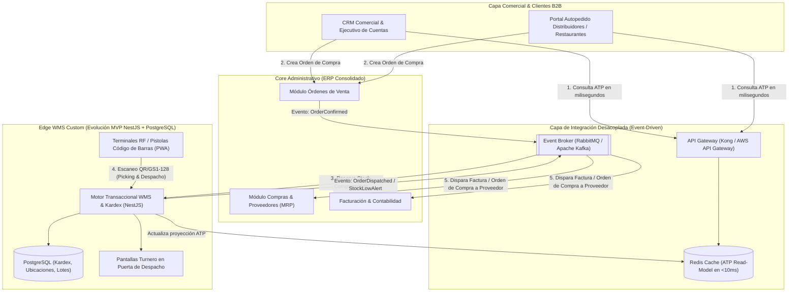
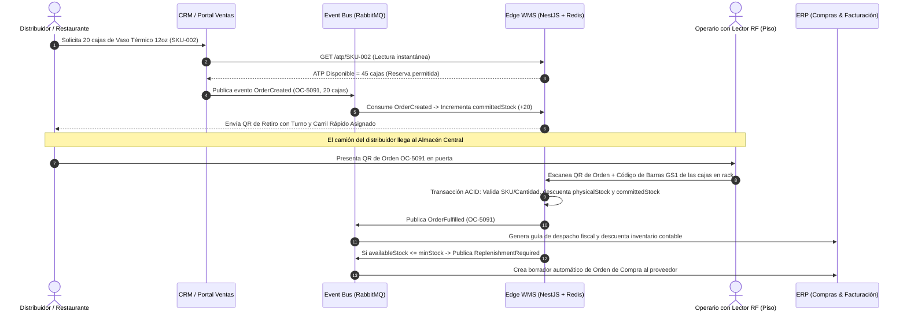

# 🏗️ Propuesta Arquitectónica Estratégica a Largo Plazo (Fase 3)

**Para:** Dirección de Tecnología y Gerencia de Operaciones (Juliam Corp LLC)  
**Propósito:** Definir la arquitectura industrial definitiva para escalar la operación de distribución de insumos gastronómicos (múltiples almacenes, alto volumen de órdenes B2B y captura física en piso sin fricción humana).

---

## 1. Visión Ejecutiva: ¿Por qué un enfoque Híbrido (ERP + CRM + WMS Ligero)?

Una vez estabilizada la crisis inmediata con la **Fase A (Contingencia)** y centralizado el control transaccional con la **Fase B (MVP Web)**, el crecimiento de Juliam Corp LLC hacia múltiples centros de distribución y miles de pedidos semanales de restaurantes exige evolucionar hacia una **Arquitectura Empresarial Composable (Híbrida)**.

En la industria de distribución Horeca (*Hoteles, Restaurantes y Catering*), fracasan dos extremos comunes:
1. **El error de "Construir todo desde cero" (100% Custom):** Intentar programar internamente módulos de contabilidad fiscal, cuentas por pagar a fábricas de plástico/vidrio, facturación electrónica y nómina desperdicia meses de ingeniería en problemas que los ERPs comerciales ya tienen resueltos.
2. **El error de "Usar pantallas de ERP tradicional en el piso del almacén" (100% Monolito ERP):** Los ERPs tradicionales tienen interfaces pesadas diseñadas para contadores en escritorio, con 12 campos por pantalla. Cuando un montacarguista o despachador en un pasillo caluroso tiene que hacer 15 clics para dar salida a 10 cajas de vasos, vuelve a anotar en un papel o crea un Excel paralelo.

### La Solución Industrial Sostenible: **Core ERP/CRM Consolidado + Edge WMS Custom de Alta Velocidad**

| Capa de Negocio | Decisión (*Buy vs. Build*) | Tecnología Recomendada | Responsabilidad Principal |
| :--- | :--- | :--- | :--- |
| **1. Finanzas, Compras e Importaciones** | **BUY (Comprar / Adoptar ERP)** | **Odoo Enterprise** o **SAP Business One / NetSuite** | Órdenes de compra a proveedores, costeo por lote/contenedor marítimo, facturación fiscal, contabilidad y MRP de reabastecimiento. |
| **2. Ventas B2B y Relación con Restaurantes** | **BUY (Adoptar CRM + Portal B2B)** | **HubSpot CRM / Odoo Sales** + Portal de Autopedido B2B | Gestión de cuentas de distribuidores, límites de crédito, pedidos recurrentes semanales y consulta de **ATP en tiempo real** antes de confirmar la venta. |
| **3. Ejecución en Piso de Almacén y Línea de Despacho (WMS)** | **BUILD (Evolución de nuestro MVP NestJS + React)** | **Microservicio WMS en NestJS + PWA para Pistolas Lectoras RF (Zebra/Honeywell)** | Recepción ciega con código de barras **GS1-128/QR**, ubicación por pasillo/rack, *Wave Picking*, Carril Rápido de despacho y Kardex en tiempo real. |

---

## 2. Diagrama de Arquitectura Industrial Integrada

---

## 3. Flujo Operativo End-to-End (Eliminación Definitiva de las Filas)

---

## 4. Pilares Técnicos de la Solución Industrial

### 4.1 Erradicación del Teclado en Piso mediante Códigos de Barras (GS1-128 / QR)
- **Problema actual:** Un operario escribiendo `sku 001` o `"12 cajas"` en un teclado siempre cometerá errores bajo presión.
- **Solución definitiva:** Cada tarima, bulto y caja maestra que entra por recepción recibe (o trae de fábrica) una etiqueta estándar **GS1-128 / QR** que codifica `(01) GTIN/SKU + (37) Cantidad por Empaque + (10) Lote`.
- Los operarios utilizan lectores inalámbricos (o dispositivos Android rugerizados tipo Zebra TC21 ejecutando nuestra interfaz React en modo PWA):
  - **En Recepción:** Escanean la orden de compra del proveedor y disparan el láser a cada bulto recibido.
  - **En Picking/Despacho:** El sistema les indica el pasillo y rack exacto (`Pasillo B - Rack 04 - Nivel 1`). Si el operario intenta escanear un contenedor de `16oz` cuando el pedido pide `24oz`, la pistola emite una vibración y alerta sonora inmediata (**Poka-Yoke físico**).

### 4.2 Sincronización Resiliente ERP ↔ WMS (Patrón Transactional Outbox)
- Para evitar que una caída temporal de internet o del ERP detenga los camiones en la puerta del almacén:
  - El **Edge WMS (NestJS + PostgreSQL)** puede operar con baja latencia local.
  - Utiliza el patrón **Transactional Outbox**: dentro de la misma transacción ACID donde se registra el movimiento en `inventory_movements`, se inserta el evento en una tabla `outbox_events`.
  - Un worker asíncrono publica los eventos hacia el **Event Bus (RabbitMQ / Kafka)** con garantía *At-Least-Once Delivery* e **idempotencia** (`movement_id` como `idempotency_key`), asegurando que el ERP y el WMS jamás se desincronicen ni dupliquen descuentos de stock.

### 4.3 Clasificación ABC y Conteo Cíclico Automatizado (Cycle Counting)
- En lugar de cerrar el almacén una vez al mes para contar todo el inventario:
  - **Clase A (20% de SKUs que generan el 80% de las salidas: vasos térmicos, contenedores bisagra 8x8, servilletas):** El WMS genera automáticamente una tarea de conteo rápido de 5 minutos en la pistola del operario cada 3 días.
  - **Clase B (rotación media):** Conteo quincenal.
  - **Clase C (baja rotación):** Conteo mensual.

### 4.4 Motor de Reabastecimiento Predictivo (Min/Max Dinámico)
- En el MVP actual, `minStock` es un umbral fijo configurado por SKU.
- En la arquitectura definitiva, el módulo de compras calcula dinámicamente el **Punto de Reorden ($ROP$)** basándose en la demanda real de las últimas 4 semanas y el tiempo de entrega (*Lead Time*) de cada fabricante:

$$ROP = (\text{Demanda Diaria Promedio} \times \text{Lead Time del Proveedor en Días}) + \text{Stock de Seguridad}$$

---

## 5. Hoja de Ruta de Evolución (Sin Detener el Almacén)

| Etapa | Horizonte | Entregable Operativo |
| :--- | :--- | :--- |
| **Fase A (Ejecutada)** | **Día 1** | Congelamiento de Excels sueltos, script `consolidate.ts`, triaje de fila y plantilla maestra Poka-Yoke. |
| **Fase B (Ejecutada)** | **Semana 1** | **MVP Web Centralizado (React + NestJS + PostgreSQL + Docker)** operando en piso con matriz ATP en vivo y transacciones ACID. |
| **Fase C (Hardening Piso)** | **Mes 1 - 2** | Incorporación de lectores de códigos de barras USB/Bluetooth conectados al MVP Web, impresión de etiquetas QR por bulto y gestión de ubicaciones (`Pasillo/Rack`). |
| **Fase D (Integración ERP/CRM)** | **Mes 3 - 6** | Conector de eventos asíncrono entre el WMS de piso y el ERP/CRM corporativo para automatizar reservas de stock desde el momento de la venta comercial y órdenes de compra automáticas a proveedores. |
